<p align="center">
  
</p>

<h1 align="center">Sentio</h1>

<p align="center">
  <strong>Ekranın öbür ucundaki sınıfı hissedin.</strong><br />
  Çevrim içi derslerde öğrencilerin yüz ifadesini ve dikkatini kendi cihazlarında çözümleyen,<br />
  öğretmene yalnızca sınıfın nabzını gönderen açık kaynaklı sınıf analitiği.
</p>

<p align="center">
  <a href="https://sonerkeser.github.io/Sentio/">Tanıtım ve indirme sayfası</a> ·
  <a href="https://github.com/SonerKeser/Sentio/releases/latest">Son sürüm</a> ·
  <a href="docs/KURULUM.md">Kurulum</a> ·
  <a href="docs/MIMARI.md">Mimari</a> ·
  <a href="docs/GIZLILIK.md">Gizlilik ve etik</a>
</p>

<p align="center"><sub>Sentio, Latincede "hissediyorum" demektir. Proje 1.2 sürümüne kadar Sezgi adını taşıyordu.</sub></p>

<p align="center">
  <a href="https://github.com/SonerKeser/Sentio/actions/workflows/ci.yml"></a>
  <a href="LICENSE"></a>
  
  
</p>

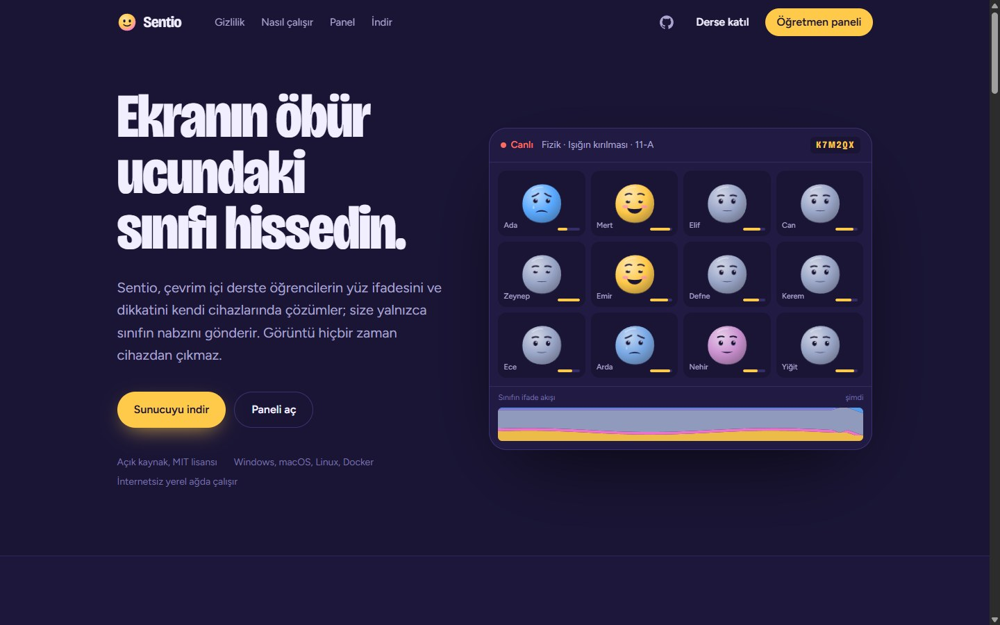

## Nedir?

Video konferansla verilen derste öğretmen, küçük kamera karelerinden kimin zorlandığını, kimin koptuğunu göremez. Sentio bu boşluğu doldurur:

- Öğrenci derse **altı karakterlik bir kodla** tarayıcıdan ya da Sentio Masaüstü uygulamasından katılır ve açık rıza verir.
- Kamerası **kendi cihazında** çözümlenir: yüz bulma, 468 noktalı yüz ağı, iris ve yedi sınıflı ifade modeli tarayıcıda, ekran kartında çalışır. **Görüntü hiçbir yere gönderilmez.**
- Öğretmenin paneline saniyede bir yalnızca sayılar akar. Sentio kısa dalgalanmaları süzer; bir öğrencinin ifadesi belirlenen süre boyunca olumsuz kalırsa, dikkati dağılırsa, yorgun görünürse ya da sınıfın büyük kısmı zorlanıyorsa **uyarı** düşer ve öğrenciye nazik bir **destek bildirimi** gider.
- Yüz ifadesi tek başına yetmediği için öğrenci **"Anlamadım"** diyebilir, **söz isteyebilir**, **"Yavaşlar mısınız?"** diyebilir; öğretmen tek dokunuşla **yoklama** açar, dersi **bölümlere** ayırır, **mola** verir.
- Ders bitince bölüm bölüm ölçümler, yoklama sonuçları, **ısı haritası** ve öğrenci özetleriyle bir **rapor** hazırdır; Excel, CSV ve PDF olarak alınır. **Dönem analitiği** bir sınıfın dersler boyunca seyrini gösterir.

Bu proje, eski bir akademik denemenin ([EmotionDedect](docs/ESKI-SISTEM-ANALIZI.md)) fikrini sıfırdan, çalışan ve gizliliği önceleyen bir sisteme dönüştürür.

## Ekran görüntüleri

| Canlı öğretmen paneli | Öğrenci ekranı |
| --- | --- |
| 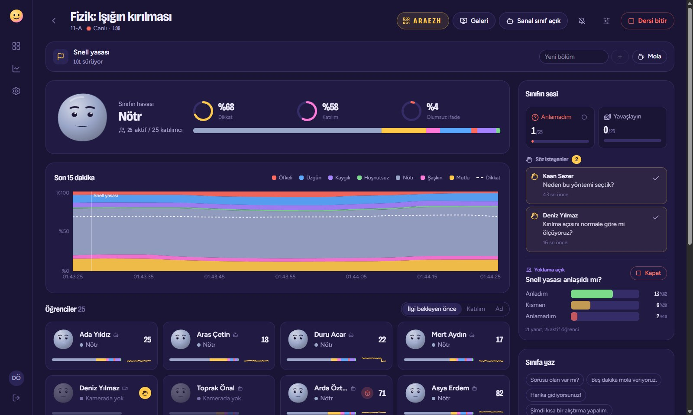 | 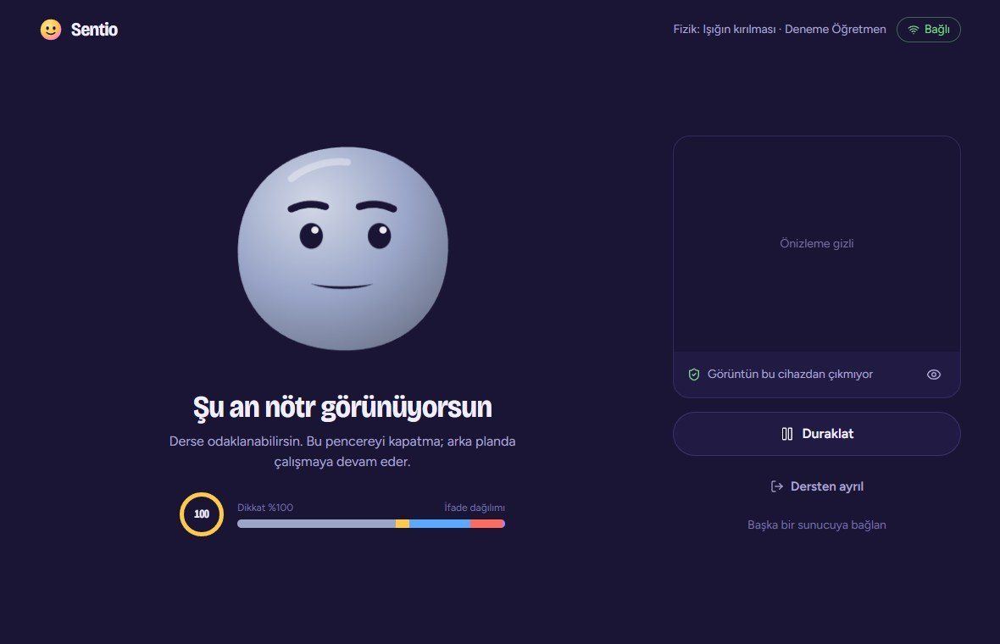 |
| **Ders raporu** | **Destek bildirimi** |
| 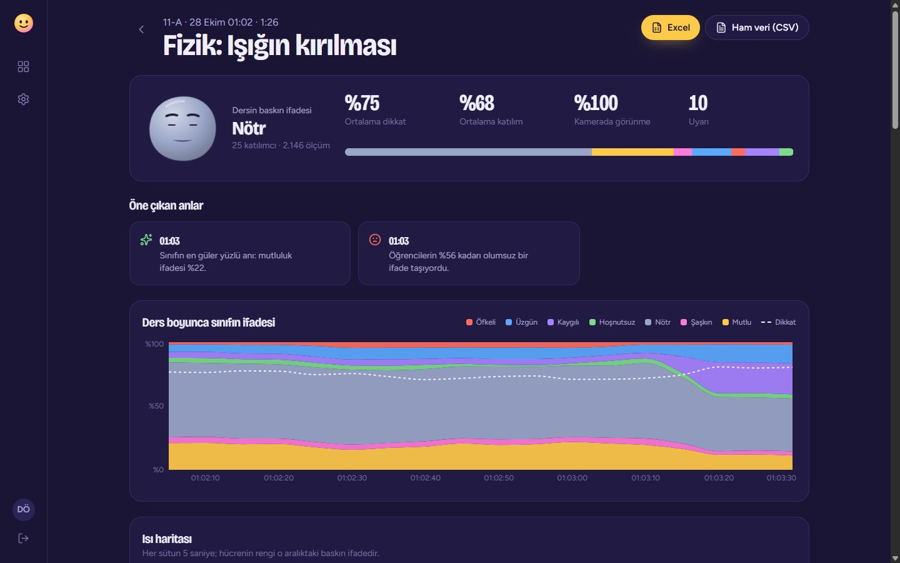 | 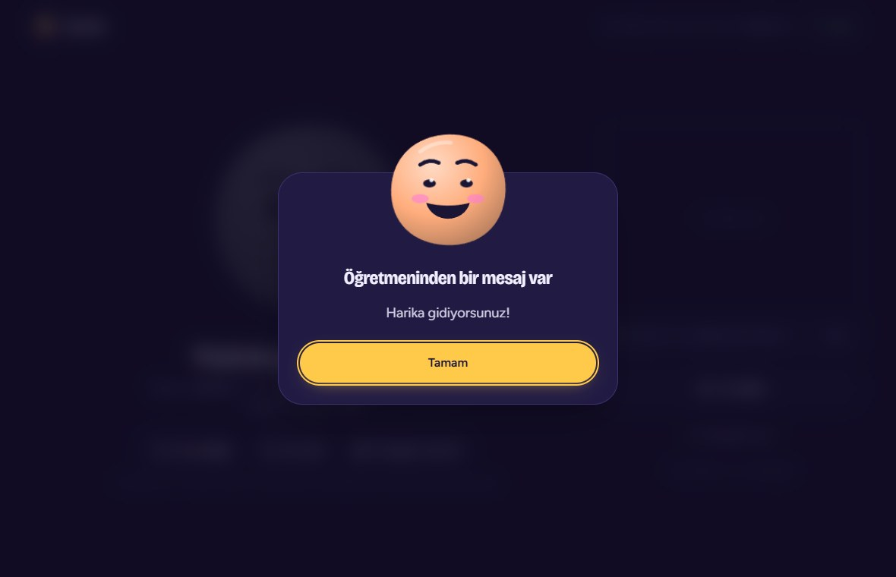 |
| **Öğrenci × zaman ısı haritası** | **Açık rıza** |
| 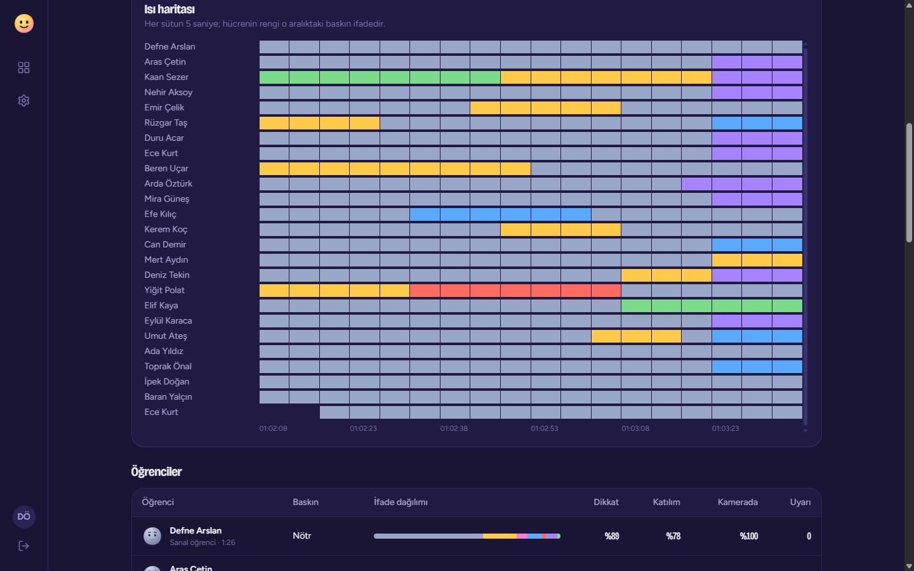 | 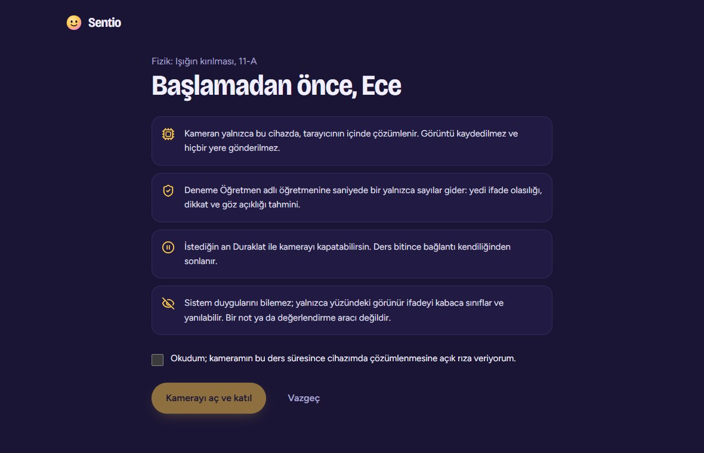 |
| **Sınıfın sesi: yoklama ve söz istekleri** | **Öğrencide yoklama** |
| 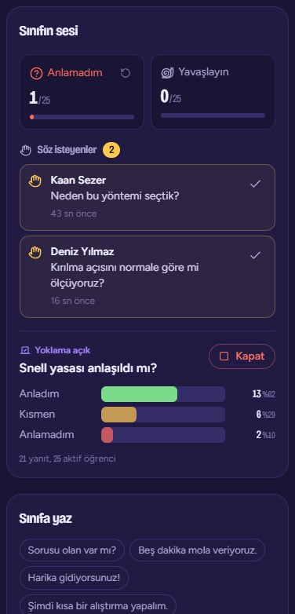 | 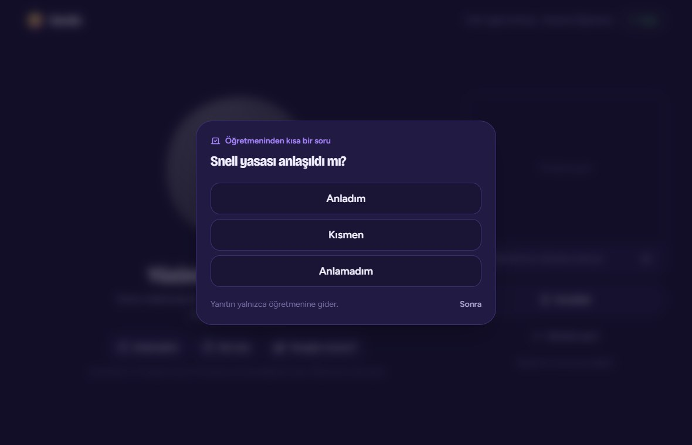 |
| **Bölümler ve yoklama sonuçları** | **Dönem analitiği** |
| 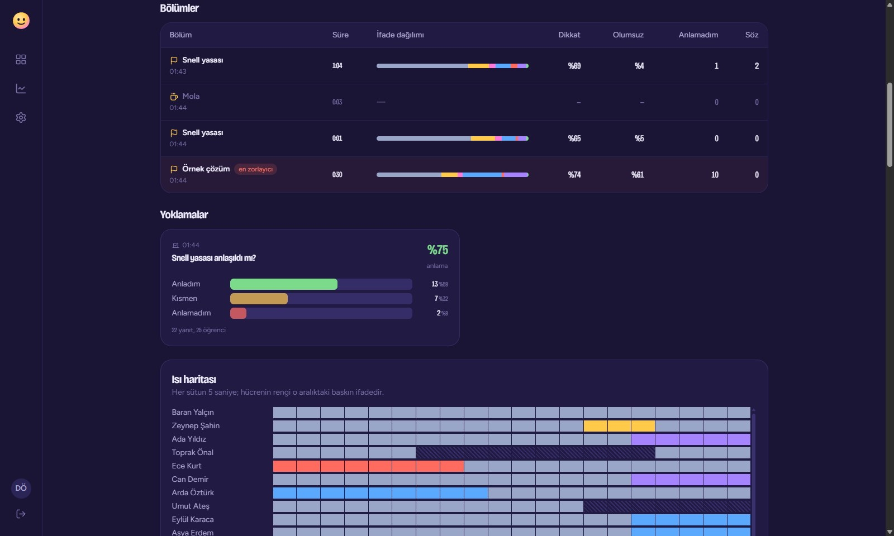 | 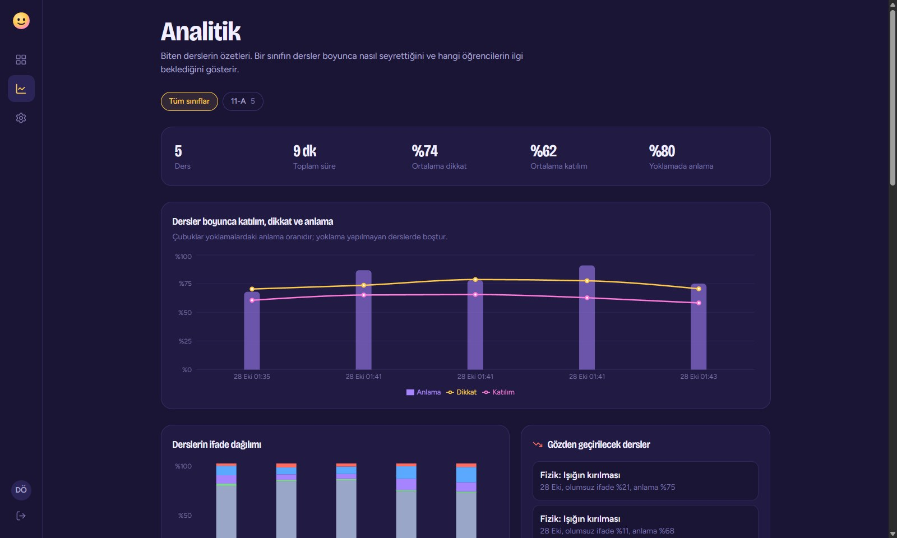 |
| **Öğrencide mola** | **İndirme sayfası** |
| 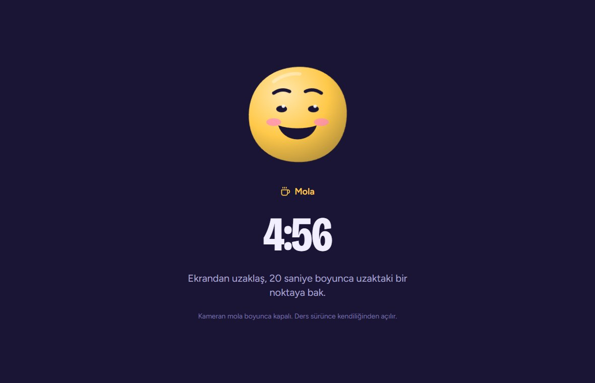 | 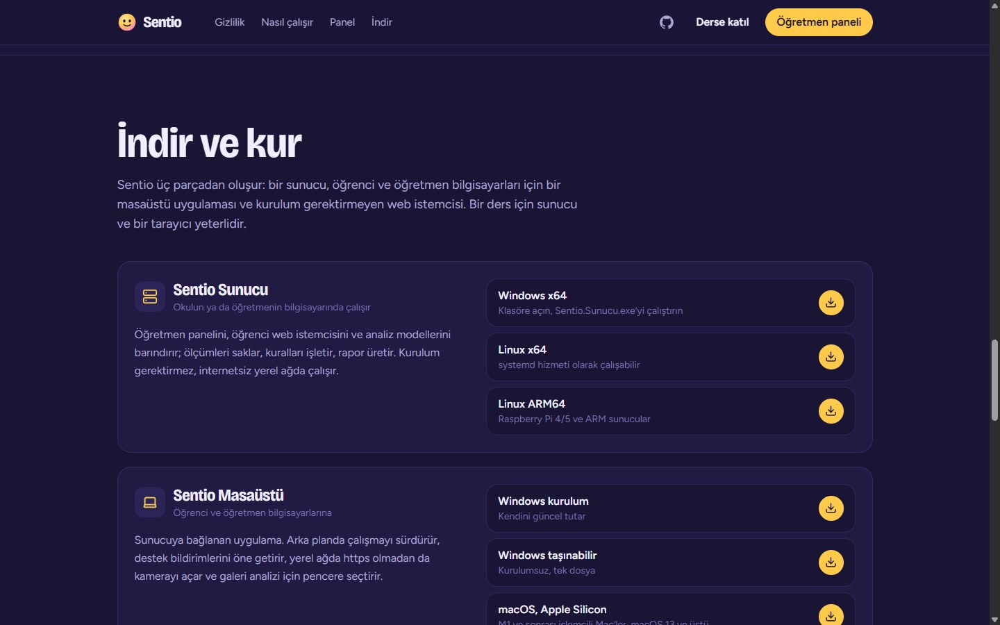 |

## Öne çıkanlar

- **Gizlilik tasarımın merkezinde:** görüntü cihazdan çıkmaz, yüz tanıma yapılmaz, açık rıza ekranı, öğrencinin istediği an duraklatabilmesi, anonim mod, otomatik veri silme.
- **Zamana dayalı kural motoru:** üstel yumuşatma, kopma toleransı, kalıcılık eşiği ve bekleme süresi; öğrenci ve sınıf geneli kurallar. Ayarlar ders sürerken değiştirilebilir.
- **Sınıfın sesi:** "Anlamadım", söz isteme ve "Yavaşlar mısınız?" sinyalleri; anlama, evet/hayır, çoktan seçmeli ve puan yoklamaları canlı sonuçlarla. Öğrencilerin %30'u anlamadığını belirtirse öğretmene uyarı düşer.
- **Ders akışı:** bölümler grafikte bant olarak görünür, rapor her bölümü ayrı değerlendirir; mola boyunca kameralar kapanır, süre dolunca ders kaldığı yerden sürer.
- **Dönem analitiği:** sınıf bazında dersler arası katılım, dikkat ve anlama eğilimi; gözden geçirilecek dersler; ilgi bekleyen öğrenciler.
- **Öğrenci hakları:** ders sonunda yalnızca öğrencinin cihazında hesaplanan kişisel özet; ayrılırken "verilerimi sil" seçeneği.
- **Yönetim:** sunucu durum kartı, tek tıkla tutarlı veritabanı yedeği, arka planda masaüstü bildirimi ve sesli uyarı.
- **Galeri analizi:** öğrenciler hiçbir şey kuramıyorsa Zoom, Meet ya da Teams penceresini paylaşın; galerideki yüzler döşemeli taramayla bulunur, galeri düzeni değişse de izlenir.
- **Sanal sınıf:** öğrenci olmadan paneli denemek ve tanıtmak için mizaç sahibi sanal öğrenciler; ölçümleri gerçek öğrencilerle aynı hattan geçer.
- **Kendi kendine yeten sunucu:** tek dosya, kurulum yok, internet gerekmez; modeller ve arayüz içinde. Yerel ağda kendini duyurur, masaüstü uygulaması onu kendiliğinden bulur.
- **Canlı ve hareketli arayüz:** her öğrencinin ifadesini yansıtan animasyonlu maskot, duygu tayfıyla renklenen grafikler, karekodlu davet.

## Hızlı başlangıç

1. **Sunucuyu indirin:** [Windows](https://github.com/SonerKeser/Sentio/releases/latest/download/Sentio-Sunucu-win-x64.zip) · [Linux x64](https://github.com/SonerKeser/Sentio/releases/latest/download/Sentio-Sunucu-linux-x64.tar.gz) · [Linux ARM64](https://github.com/SonerKeser/Sentio/releases/latest/download/Sentio-Sunucu-linux-arm64.tar.gz) · [Docker](docs/KURULUM.md#docker)
2. `Sentio.Sunucu` dosyasını çalıştırın; `http://localhost:5757/panel` açılır. İlk yönetici hesabını oluşturun.
3. **Yeni ders başlatın.** Öğrencilerle kodu ya da karekodu paylaşın.
4. Öğrenciler `http://sunucu-adresi:5757/katil` sayfasından ya da Sentio Masaüstü uygulamasıyla ([Windows](https://github.com/SonerKeser/Sentio/releases/latest/download/Sentio-Masaustu-Kurulum.exe) · [macOS](https://sonerkeser.github.io/Sentio/#indir) · [Linux](https://github.com/SonerKeser/Sentio/releases/latest/download/Sentio-Masaustu-linux-x64.AppImage)) katılır.

Öğrenciniz yok mu? Dersi açın ve **Sanal sınıf** düğmesiyle 8–32 sanal öğrenci ekleyin.

> Tarayıcılar kamerayı yalnızca https ya da localhost üzerinde açar. Yerel ağda https yoksa Sentio Masaüstü bu kısıtı yalnızca sizin sunucunuz için kaldırır. Ayrıntılar: [Kurulum › https](docs/KURULUM.md#3-https).

## Bileşenler

| Bileşen | Teknoloji | İndir |
| --- | --- | --- |
| **Sunucu** | .NET 10, ASP.NET Core minimal API, SignalR, EF Core + SQLite, ClosedXML | [Windows x64](https://github.com/SonerKeser/Sentio/releases/latest/download/Sentio-Sunucu-win-x64.zip), [Linux x64](https://github.com/SonerKeser/Sentio/releases/latest/download/Sentio-Sunucu-linux-x64.tar.gz), [Linux ARM64](https://github.com/SonerKeser/Sentio/releases/latest/download/Sentio-Sunucu-linux-arm64.tar.gz) |
| **Web istemcisi** (öğretmen paneli, öğrenci, tanıtım) | React 19, Vite 7, Tailwind CSS 4, Motion, Recharts, Human (TensorFlow.js) | Sunucuyla birlikte gelir |
| **Masaüstü** (öğrenci ve öğretmen) | Electron 45 | Windows [kurulum](https://github.com/SonerKeser/Sentio/releases/latest/download/Sentio-Masaustu-Kurulum.exe), [taşınabilir](https://github.com/SonerKeser/Sentio/releases/latest/download/Sentio-Masaustu-Tasinabilir.exe); macOS [Apple Silicon](https://github.com/SonerKeser/Sentio/releases/latest/download/Sentio-Masaustu-mac-arm64.dmg), [Intel](https://github.com/SonerKeser/Sentio/releases/latest/download/Sentio-Masaustu-mac-x64.dmg); Linux [AppImage](https://github.com/SonerKeser/Sentio/releases/latest/download/Sentio-Masaustu-linux-x64.AppImage) |

## Nasıl çalışır?

Öğrencinin bir saniyede gönderdiği her şey:

```json
{ "d": [0.62, 0.21, 0.08, 0.04, 0.01, 0.03, 0.01], "dikkat": 0.86, "goz": 0.93, "yuz": true }
```

`d`: nötr, mutlu, şaşkın, üzgün, öfkeli, kaygılı, hoşnutsuz olasılıkları. Sunucu bu ölçümleri yumuşatır, kurallardan geçirir, saklar ve öğretmene saniyelik anlık görüntü olarak yayınlar. Ayrıntılı akış, kurallar, protokol ve veri modeli için: [docs/MIMARI.md](docs/MIMARI.md).

## Proje yapısı

```
src/Sentio.Sunucu/          .NET 10 sunucu (API, SignalR, kural motoru, raporlar)
tests/Sentio.Sunucu.Testleri xUnit: kural motoru, rapor, uçtan uca SignalR akışı
web/                       React arayüzü; derlemesi sunucunun wwwroot klasörüne çıkar
masaustu/                  Electron masaüstü istemcisi
betikler/                  Sürüm paketleme
docs/                      Kurulum, mimari, gizlilik, eski sistem analizi
```

## Geliştirme

```bash
dotnet run --project src/Sentio.Sunucu        # http://localhost:5757
cd web && npm install && npm run dev          # http://localhost:5173 (API'yi 5757'ye yönlendirir)
dotnet test && (cd web && npm test)           # sunucu ve analiz testleri
cd masaustu && npm install && npm run basla   # masaüstü istemcisi
pwsh betikler/paketle.ps1                     # sürüm paketleri
```

## Sorumlu kullanım

Yüz ifadesi iç duygunun kesin göstergesi değildir; Sentio bir notlandırma ya da değerlendirme aracı değildir. Kullanmadan önce öğrencileri (reşit değillerse velilerini) bilgilendirip açık rıza alın. AB Yapay Zekâ Yasası, eğitim kurumlarında duygu çıkarımı yapan sistemleri tıbbi ve güvenlik amaçları dışında yasaklar. Ayrıntılar ve örnek aydınlatma metni: [docs/GIZLILIK.md](docs/GIZLILIK.md).

## Lisans

[MIT](LICENSE) © 2026 Soner Keser. Yüz analizi [Human](https://github.com/vladmandic/human) kütüphanesiyle (MIT) yapılır; kullanılan modellerin lisansları için Human deposuna bakın.
