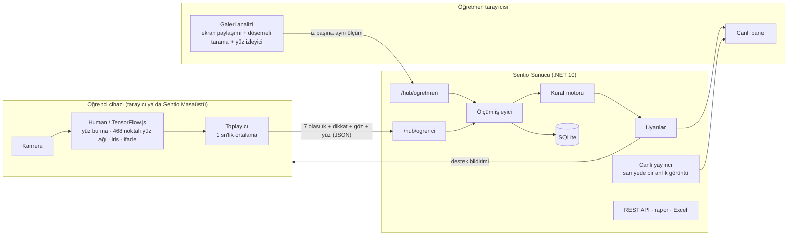

# Mimari



## İlkeler

1. **Görüntü cihazdan çıkmaz.** Bütün yüz çözümlemesi istemcide yapılır. Sunucuya her örnekleme aralığında (varsayılan 1 sn) yalnızca şu gider:

   ```json
   { "d": [0.62, 0.21, 0.08, 0.04, 0.01, 0.03, 0.01], "dikkat": 0.86, "goz": 0.93, "yuz": true }
   ```

   `d` dizisinin sırası: nötr, mutlu, şaşkın, üzgün, öfkeli, korku (kaygılı), iğrenme (hoşnutsuz).
2. **Tek kare değil, eğilim.** Kurallar yumuşatılmış ve zamana yayılmış ölçümlere bakar; tek bir yanlış sınıflama uyarı üretmez.
3. **Kendi kendine yeten sunucu.** Web arayüzü ve modeller sunucuyla gelir; internetsiz okul ağında çalışır.

## Bileşenler

### Sunucu (`src/Sentio.Sunucu`)

| Klasör | İçerik |
| --- | --- |
| `Alan/` | Duygu sınıfları, valans ağırlıkları, katılım puanı. |
| `Canli/` | Bellek içi oturum durumu (`CanliOturumDeposu`), ölçüm hattı (`OlcumIsleyici`), kural motoru, saniyelik yayıncı, toplu veritabanı yazıcısı. |
| `Hublar/` | SignalR merkezleri: öğretmen (çerez kimliği) ve öğrenci (katılım jetonu). |
| `Api/` | Hesap, öğretmen yönetimi, oturumlar, katılım, rapor ve sistem uçları (minimal API). OpenAPI tanımı `/openapi/v1.json`. |
| `Raporlar/` | Rapor hesaplama (öğrenci özetleri, zaman dilimleri, ısı haritası, öne çıkan anlar) ve Excel/CSV dışa aktarımı. |
| `Hizmetler/` | Oturum yaşam döngüsü, sanal sınıf simülatörü, veri saklama temizliği, yerel ağ duyurusu. |
| `Veri/` | EF Core veri modeli ve göçler (SQLite, WAL kipi). |

**Ölçüm hattı.** `OlcumIsleyici.IsleAsync`: doğrula ve normalleştir → üstel yumuşatma (α = 0,35) → kural motoru → ölçümü toplu yazıcı kuyruğuna ekle → tetiklenen kural varsa uyarıyı kaydet, öğretmen grubuna yayınla, öğrenciye destek bildirimi gönder. Öğrenci kamerası, galeri analizi ve simülasyon aynı hattı kullanır.

**Kurallar** (`Canli/KuralMotoru.cs`):

| Kural | Koşul | Varsayılan |
| --- | --- | --- |
| Kalıcı olumsuz ifade | Baskın yumuşatılmış ifade izlenen bir olumsuz sınıfta ve olasılığı ≥ %35; 4 sn'den kısa kopmalar tolere edilir | 20 sn |
| Dikkat dağınıklığı | Son 30 sn'de yüz görünürken ortalama dikkat < %35 | açık |
| Yorgunluk | Son 12 sn'deki ölçümlerin %70'inde göz açıklığı < %25 | açık |
| Kamerada görünmeme | 45 sn boyunca yüz yok | açık |
| Sınıf geneli olumsuz | Yüzü görünen en az 3 öğrencinin %40'ı 15 sn boyunca olumsuz | açık |
| Sınıf geneli dikkat | Ortalama dikkat 30 sn boyunca < %40 | açık |

Her kural öğrenci başına bekleme süresine (varsayılan 120 sn) tabidir; sınıf kuralları için en az 180 sn.

**Dikkat tahmini** (istemci, `web/src/analiz/olcum.ts`): baş yönü (yaw/pitch) kişinin öğrenilen doğal oturuş açısına göre değerlendirilir (kamera ekranın üstünde olduğundan herkes biraz aşağı bakar), iris bakış gücü ve göz açıklığı (EAR) ile çarpılır.

### Web (`web/`)

React 19, React Router 7, Vite 7, Tailwind CSS 4, Motion 12, Recharts 3, `@microsoft/signalr`, `@vladmandic/human` 3.3.

| Yol | Sayfa |
| --- | --- |
| `/` | Tanıtım ve indirme sayfası (GitHub Pages'te de yayımlanır) |
| `/katil`, `/katil/:kod` | Öğrenci istemcisi: katılım, açık rıza, canlı ders ekranı |
| `/panel` | Öğretmen: giriş/kurulum, dersler, canlı panel, rapor, ayarlar |

Analiz motoru yalnızca gerektiğinde yüklenir (tanıtım sayfası ~160 KB gzip). Öğrenci sekmesi arka planda kalsa da analiz sürsün diye kare zamanlayıcısı bir Web Worker'dan gelir.

**Galeri analizi.** Paylaşılan pencere kare kare taranır; küçük yüzleri kaçırmamak için kare örtüşen 2×2 ya da 3×3 döşemelere bölünür, sonuçlar çakışma ayıklamasıyla birleştirilir. Yüzler kareler arasında yüz tanımlayıcısı benzerliği ve kutu çakışmasıyla izlenir; galeri düzeni değişse de kimlik korunur. Tanımlayıcılar yalnızca tarayıcı belleğindedir.

### Masaüstü (`masaustu/`)

Electron 45. Arayüz sunucudan yüklenir; uygulama şunları ekler:

- Yerel ağda https olmadan kamera (yalnızca seçilen Sentio sunucusu güvenli köken sayılır),
- Arka planda çalışmayı sürdürme (sistem tepsisi, zamanlayıcı kısıtlaması kapalı),
- Destek bildiriminde pencereyi öne getirme ve ardından eski haline döndürme,
- Galeri analizi için pencere seçici,
- UDP 5758 duyurularıyla yerel ağdaki sunucuları bulma,
- GitHub sürümlerinden kendini güncelleme (Windows kurulum sürümü ve Linux AppImage; macOS'ta kendini güncelleme Apple imzası gerektirdiğinden kapalıdır).

Paketler Windows (NSIS kurulum ve taşınabilir), macOS (Apple Silicon ve Intel için ayrı dmg, ad-hoc imzalı) ve Linux (x64 AppImage) için `surum.yml` iş akışında üretilir ve yüklenmeden önce açılıp denenir. AppImage FUSE 2 gerektirmeyen yeni çalıştırıcıyla gelir; başlatıcı, kullanıcı ad alanlarının kısıtlandığı sistemlerde (Ubuntu 24.04) Chromium korumalı alanını kendisi kapatır, diğerlerinde açık bırakır.

Güvenlik: `contextIsolation`, `sandbox`, `nodeIntegration: false`; sayfaya yalnızca dört işlevlik dar bir köprü açılır; izinler (kamera, ekran paylaşımı) yalnızca seçilen sunucu kökenine verilir, mikrofon hiç istenmez; sunucu dışındaki bağlantılar varsayılan tarayıcıda açılır.

## Etkileşim katmanı

Duygu tahmini öğrencinin iç dünyasını bilemez; Sentio bunu öğrencinin açık beyanlarıyla tamamlar (`Hizmetler/EtkilesimYoneticisi.cs`).

| Özellik | Davranış |
| --- | --- |
| Sinyaller | "Anlamadım" ve "Yavaşlar mısınız" 90 sn sonra kendiliğinden düşer; aynı beyan yinelenince süresi uzar. Söz isteği öğretmen yanıtlayana ya da öğrenci geri alana dek kalır. Öğrenci başına 3 sn hız sınırı. |
| Sınıf geneli | Aktif öğrencilerin en az %30'u (en az 2 kişi) "Anlamadım" derse öğretmene uyarı düşer (120 sn bekleme). |
| Yoklama | Aynı anda bir açık yoklama; türler: anlama (Anladım/Kısmen/Anlamadım), evet/hayır, çoktan seçmeli (2-6 seçenek), 1-5 puan. Yanıt, yoklama kapanana dek değiştirilebilir. Anlama oranı = (Anladım + Kısmen/2) / yanıt. |
| Bölüm | Açık bölüm kapanır, yenisi açılır. Rapor her bölüm için ifade dağılımı, dikkat, olumsuz oran ve sinyal sayısı verir. |
| Mola | Planlanan bitişle saklanır; molada ölçümler işlenmez, sınıf kuralları çalışmaz, açık yoklama kapanır, kural sayaçları sıfırlanır. Süre dolunca moladan önceki bölüm sürer. |

Sunucu ders sürerken yeniden başlarsa açık yoklama (yanıtlarıyla), bölümler, mola ve söz istekleri veritabanından geri yüklenir.

## Dönem analitiği

Ders bitince `IstatistikHesaplayici` raporu hesaplayıp `OturumIstatistikleri` ve `KatilimciIstatistikleri` tablolarına özet yazar; analitik sayfası ham ölçümleri taramadan bu özetlerden çalışır. Öğrenciler dersler arasında Türkçe büyük/küçük harf kurallarıyla küçültülmüş adlarıyla eşleştirilir; anonim dersler ve verilerini silen öğrenciler eşleştirmeye girmez.

## Gerçek zamanlı protokol

**Öğrenci → sunucu** (`/hub/ogrenci`, `access_token` = katılım jetonu): `Okuma(OkumaGirdisi)`, `Duraklat(bool)`, `Sinyal(tur, metin?)`, `SinyalGeriAl(tur)`, `YoklamaYanitla(yoklamaId, secim)`, `Ayril(verileriSil)`.
**Sunucu → öğrenci:** `Durum(OgrenciDurumu)` bağlanınca, `Ayarlar`, `Durtme`, `Yoklama`, `YoklamaKapandi`, `Mola(MolaBildirimi?)`, `SinyalKapandi(tur)`, `OturumBitti`.

**Öğretmen → sunucu** (`/hub/ogretmen`, çerez): `Izle(oturumId)`, `Birak`, `MesajGonder`, `YoklamaBaslat`, `YoklamaKapat`, `SinyalYanitla`, `SinyalleriTemizle`, `BolumBaslat`, `MolaBaslat(dakika)`, `MolaBitir`, `GaleriOkumalari`, `GaleriAdDegistir`.
**Sunucu → öğretmen:** `Anlik(AnlikGoruntu)` saniyede bir (sınıf özeti, katılımcılar ve etkileşim durumu), `Uyari`, `OturumGuncellendi`, `OturumBitti`.

## Veri modeli

`Ogretmen` → `Oturum` (ayarlar gömülü) → `Katilimci` (kaynak: kamera, galeri, simülasyon), `Okuma` (saniyelik, yüzdeler bayt olarak), `Uyari`, `Yoklama` → `YoklamaYaniti`, `Sinyal`, `Bolum`, `OturumIstatistigi`, `KatilimciIstatistigi`. Okumalar `(OturumId, ZamanMs)` ve `(KatilimciId, ZamanMs)` dizinleriyle tutulur; 30 öğrencilik 40 dakikalık bir ders yaklaşık 2 MB yer kaplar.

## Güvenlik

- Parolalar ASP.NET Core Identity özetleyicisiyle (PBKDF2) saklanır; çerezler HttpOnly, SameSite=Strict; veri koruma anahtarları Windows'ta DPAPI ile şifrelenir.
- Katılım jetonu 256 bit rastgele; veritabanında yalnızca SHA-256 özeti tutulur ve ders bitince geçersiz olur.
- Giriş ve katılım uçlarında IP başına hız sınırı; öğretmenler yalnızca kendi derslerini görür (yönetici hepsini).
- CSV dışa aktarımında formül enjeksiyonuna karşı koruma; güvenlik başlıkları (nosniff, DENY, Permissions-Policy).
